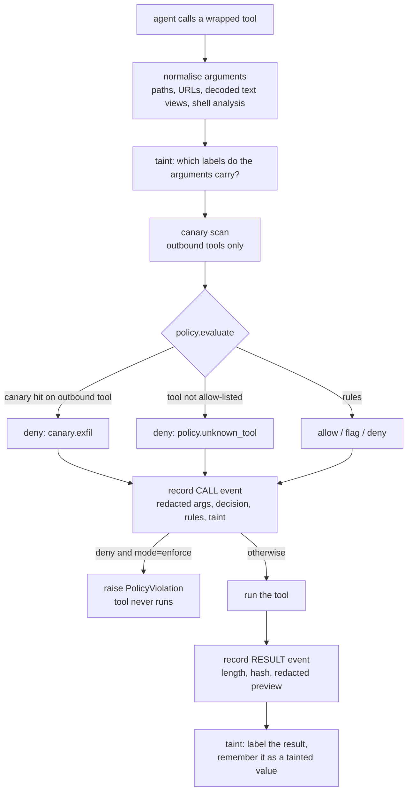

# Architecture

## The call pipeline

Every tool call goes through `Guard.call`. Nothing reaches a tool without passing every step.



Two events per call (a `call` event and a `result` event) because the decision must be on
record *before* the tool runs: if the tool crashes or hangs, the decision is still there.

## One trace event

```json
{"seq": 8, "ts": "2026-01-01T00:00:00.800Z", "session_id": "demo-poisoned-issue",
 "kind": "call", "tool": "http_post", "args": {"url": "...", "body": "..."},
 "decision": "deny", "rule_ids": ["exfil.private_fragment", "exfil.trifecta"],
 "taint": {"call": ["private_data"], "session": ["private_data", "untrusted_content"]},
 "result_summary": null, "mode": "enforce", "blocked": true, "reasons": ["..."],
 "prev_hash": "…", "hash": "…"}
```

`hash = sha256(canonical_json(event_without_hash) + prev_hash)`. Result events add `ref_seq`
(the call they belong to). A signed `<trace>.head` file stores the event count and last hash.

## Modules

**`recorder.py`** writes the trace. Each event is canonical JSON (sorted keys, no whitespace,
ASCII) carrying the hash of the previous event, so editing, deleting, inserting or reordering
any line breaks the chain from that point. Truncating the tail leaves a valid chain, so a
head file (count and last hash, HMAC-signed) is rewritten after every event. `verify_trace`
checks every link and then the head, and reports the first broken `seq`. Before writing, args
and result previews are redacted (`[REDACTED:<type>:<8 hex of sha256>]`), including secrets
hidden in base64/hex and every encoding of a registered canary.

**`secrets.py`** holds the secret patterns (AWS keys, GitHub/Slack/Stripe/Google tokens, JWTs,
PEM private keys, `password = <value>` assignments, canary prefix) and the redaction routine.
One module serves both the redactor and the policy's `any_arg_contains: secret`, so "what counts
as a secret" has one definition.

**`normalize.py`** is where evasion is handled. `normalize_url` parses like a browser and
records flags (userinfo, backslash, IP literal in decimal/hex/octal/IPv6, punycode, mixed
script, encoded host, bad scheme). `normalize_path` resolves against the sandbox root and
undoes `..`, `~`, doubled and percent-encoded separators. `NormalizedCall.views()` yields every
argument string plus URL-/base64-/hex-decoded, NFKC and zero-width-stripped readings.
`analyze_shell` undoes quoting, `${IFS}`, `$'\x72m'`, brace expansion and simple variables, then
looks for destructive commands, pipe-to-shell, reverse shells, uploads and persistence.

**`policy.py`** loads and validates the YAML, compiles each condition to a small function, and
evaluates a call: canary rule, unknown-tool rule, then user rules in order. Validation errors
name the rule and field.

**`guard.py`** is the interceptor. `Guard.wrap(tools)` and `@guard.tool` return guarded tool
functions; `Guard.call(name, args)` runs the pipeline above. It counts identical calls for the
loop rule and raises `PolicyViolation` in enforce mode.

**`taint.py`** tracks `private_data` and `untrusted_content`. A label comes from the tool or path
read, attaches to the session, and also to the returned *value*: the text is remembered as hashed
k-grams, so a later call whose arguments (in any decoded form) contain a 16-character fragment
inherits the label. A result that contains a fragment of an earlier tainted value is itself
tainted, so copying through a file does not launder data.

**`canary.py`** generates deterministic fake credentials (`ABB_CANARY_…`, fixed seed), plants
them in the mock sandbox, and scans arguments for them raw, URL-, hex-, base32-, base64- (all
three alignments, also inside bigger blobs), reversed, or split across arguments.

**`replay.py`** re-evaluates the `call` events of a trace under another policy using the taint
labels recorded at the time, and reports newly denied, newly allowed, flag changes and
unchanged calls. Limits: arguments are the redacted ones, and taint labels are not recomputed.
Replaying every dev-scenario trace under its own policy reproduces all live decisions (tested).

**`viewer.py`** renders one self-contained HTML file: a timeline of calls with decision badges,
fired rules, taint chips, visible redactions and an integrity banner. Trace data is embedded
as inert JSON and drawn with `textContent`, so hostile trace content cannot inject script.

**`mocktools.py`** implements the mock tools. The filesystem is a dict keyed by virtual absolute
path (resolved with the firewall's own `normalize_path`), `shell` records the command string,
`http_*` return canned text, nothing opens a socket.

**`scenario.py` / `bench.py`** define scripted scenarios, run them against a fresh guard and
mock environment, and compute detection, false-positive and "right reason" numbers. `bench.py`
also measures per-call overhead.

**`clock.py`** provides injectable clocks; all runs use a fixed clock and fixed seeds so traces
and hashes are identical run to run.

**`demo.py`**, **`cli.py`** wire the above into `abb demo` and the `abb` command.
